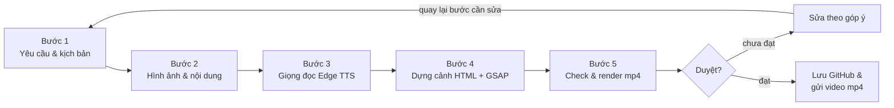

# Video THAIFEX 2027 – Báo cáo chi tiết quy trình thực hiện

09/11/2026 · Andrew

## Tổng quan

Dự án tạo ra video hướng dẫn THAIFEX 2027 dài 2:47 (1920x1080, 30fps, mp4) hoàn toàn bằng code: mỗi cảnh là một trang HTML có chuyển động GSAP, được HyperFrames chụp từng khung và ghép với giọng đọc, nhạc nền, hiệu ứng âm thanh.

**Cấu trúc thư mục** (repo [andrewtdo74-cyber/Motion-Studio-video](https://github.com/andrewtdo74-cyber/Motion-Studio-video)):

| Đường dẫn | Nội dung |
| --- | --- |
| `YEU-CAU-VIDEO-THAIFEX-2026.md` | File yêu cầu gốc: mục đích, người xem, phong cách, kịch bản thô |
| `KICH-BAN-V3.md` | Kịch bản phân cảnh: hình, chữ, lời đọc từng cảnh |
| `script-v3.md` | Lời đọc chốt (viết theo cách đọc), chia `## s1` … `## s9` |
| `thaifex-frame.md` | Phong cách hình ảnh: màu, chữ, bố cục |
| `videos/thaifex-2026/index.html` | Dòng thời gian chính: thứ tự cảnh, giọng đọc, nhạc, hiệu ứng âm thanh, chuyển cảnh |
| `videos/thaifex-2026/compositions/frames/` | 9 file cảnh `01-mo-dau.html` … `09-cta.html` |
| `videos/thaifex-2026/assets/` | Font Be Vietnam Pro, giọng đọc `voice/`, hiệu ứng `sfx/`, ảnh `booths/`, nhạc nền |
| `videos/thaifex-2026/BRIEF.md`, `STORYBOARD.md` | Brief và storyboard cho công cụ dựng |
| `videos/thaifex-2026/renders/` | File mp4 xuất ra (không đưa lên GitHub) |

## Sơ đồ quy trình



Năm bước chạy nối tiếp; người phụ trách duyệt sau mỗi lần render, góp ý được sửa ở đúng bước liên quan rồi check và render lại.

## Bước 1 – Lên yêu cầu và kịch bản

Kịch bản đi qua 3 lớp file, từ thô đến chốt; chỉ lớp cuối (`script-v3.md`) được đưa vào máy đọc.

1. **File yêu cầu** (`YEU-CAU-VIDEO-THAIFEX-2026.md`): tóm tài liệu "THAIFEX – Thông tin & kế hoạch trưng bày trên một trang giấy" thành: mục đích, người xem, độ dài, phong cách, tài nguyên cần bổ sung, kịch bản thô 9 cảnh.
2. **Kịch bản phân cảnh** (`KICH-BAN-V3.md`): mỗi cảnh ghi 3 dòng — *Hình* (minh họa gì), *Chữ* (chữ trên màn hình), *Lời đọc*. Kể theo hành trình 4 chặng; cảnh 5 (gửi hàng mẫu) được xác định là cảnh quan trọng nhất.
3. **Lời đọc chốt** (`script-v3.md`): mỗi cảnh một mục `## sN`; mỗi câu kết thúc bằng dấu chấm tạo một mốc thời gian riêng cho hình ảnh bám theo.

**Quy tắc viết lời đọc cho giọng AI:**

- Viết theo cách đọc: "Thaifex hai không hai bảy", "Băng Cốc", "xe vanh", "A F W", "điện hai mươi bốn trên hai mươi bốn", "bạt Thái".
- Tránh chữ cái đứng một mình (ví dụ "Phần B") vì Edge TTS hay đọc sai.
- Chữ trên màn hình vẫn viết bình thường ("THAIFEX 2027", "Bangkok").

**Quy tắc nội dung** (ghi trong `BRIEF.md`): không bịa ngày, hạn chót, giá, số liệu; không emoji; không nền tối; không chữ chồng lên hình; không tự phân công ai dàn dựng loại gian hàng nào. Nội dung mới (ví dụ đoạn 3 loại gian hàng) được viết thành bản nháp, người phụ trách duyệt và bổ sung, rồi mới đưa vào `script-v3.md`.

## Bước 2 – Hình ảnh và nội dung

Video dùng 2 nguồn hình: minh họa phẳng vẽ bằng code (SVG) và ảnh gian hàng thật lấy từ PDF chính thức.

**Minh họa vẽ bằng code:** gian hàng 3D giả, bản đồ Việt Nam → Bangkok, máy bay, xe van, tài liệu, bảng ngân sách, con dấu, biểu tượng chip. Tất cả dùng chung bộ màu 4 chặng và font Be Vietnam Pro, nên các cảnh đồng nhất và đổi màu một lần là đổi cả video.

| Biến màu | Chặng | Mã màu |
| --- | --- | --- |
| `--color_s1` | 1 · Chuẩn bị | #B4544D |
| `--color_s2` | 2 · Gửi hàng | #C49A4E |
| `--color_s3` | 3 · Tại Bangkok | #4F74A8 |
| `--color_s4` | 4 · Kết thúc | #5F8F6C |
| `--color_bg` / `--color_bg2` | Nền | #F5F2EC → #E9E4DA |

**Ảnh gian hàng thật:** lấy từ file "TAA27 – App Form_Regular rate from 1_7_2026.pdf", trang 5 (mục Vietnam Pavilion / Standard Shell Scheme).

1. Dùng thư viện mupdf (Node.js) đọc trang 5 và trích ảnh nhúng gốc (không chụp màn hình), giữ đúng độ phân giải trong PDF.
2. Lưu vào `assets/booths/vietnam-pavilion.png` (349×272) và `standard-booth.png` (320×270).
3. Đặt ảnh trong khung trắng bo góc, bóng đổ nhẹ; ảnh xuất hiện bằng hiệu ứng trồi lên + zoom chậm (1.12 → 1) để hòa với minh họa phẳng.
4. Ảnh được dùng ở cảnh 1 (gian Quốc gia), cảnh 3 (2 loại gian hàng), cảnh 7 và cảnh 8. Gian thô không có ảnh trong PDF nên giữ hình minh họa, đặt cùng kiểu khung.

**Nguồn nội dung:**

| Nội dung | Nguồn |
| --- | --- |
| 4 chặng, hồ sơ, gửi hàng mẫu, đi lại, khách mua, kết thúc | Tài liệu "Thông tin & kế hoạch trưng bày" (qua file yêu cầu) |
| Tiện ích gian Quốc gia và gian tiêu chuẩn (vách 2,5m, thảm, bảng tên, tủ, kệ, bàn, ghế, đèn, ổ điện; 9/18/27/36 m²; không thay đổi kết cấu) | PDF TAA27, trang 5 |
| Gian thô: thuê đơn vị thi công chính thức hoặc bên ngoài; bản vẽ phải được Ban tổ chức duyệt trước | Người phụ trách bổ sung |

## Bước 3 – Giọng đọc

Giọng đọc dùng Microsoft Edge TTS, giọng `vi-VN-HoaiMyNeural` (nữ, ấm), tốc độ mặc định; mỗi cảnh một file mp3.

1. Script `tools/edge_vo.py` đọc từng mục `## sN` trong `script-v3.md`, gửi lên Edge TTS và lưu `assets/voice/vo-0N.mp3`.
2. Cùng lúc, Edge TTS trả về **WordBoundary**: thời điểm bắt đầu/kết thúc từng từ (ví dụ "Thaifex@2.3s"). Dữ liệu này ghi vào `audio_meta.json`.
3. Độ dài file giọng quyết định độ dài cảnh: cảnh = giọng + 0,5 giây để chuyển cảnh mờ dần.
4. Khi cần Python: cài Python 3.12 + `pip install edge-tts`. Lỗi "NoAudioReceived" thỉnh thoảng xảy ra, script tự thử lại tối đa 20 lần.

**Chèn đoạn mới vào giữa cảnh có sẵn** (đoạn 3 loại gian hàng): không đọc lại cả cảnh 3 mà cắt `vo-03.mp3` tại 10,2 giây (khoảng lặng sau "…thiết kế riêng") thành `vo-03a` + `vo-03c`, chèn 3 file mới `vo-03-b1/b2/b3` vào giữa. Cách này giữ nguyên mốc thời gian của phần cũ.

**Đổi 2026 → 2027:** câu mở đầu được đọc lại; file mới vẫn dài đúng 8,424 giây nên các cảnh sau không lệch.

| File giọng | Độ dài (giây) |
| --- | --- |
| vo-01 · Mở đầu | 8,4 |
| vo-02 · Bốn chặng | 7,1 |
| vo-03 (a + b1 + b2 + b3 + c) · Chọn gian hàng | 63,7 |
| vo-04 · Hồ sơ | 7,0 |
| vo-05 · Gửi hàng mẫu | 24,8 |
| vo-06 · Đến Bangkok | 25,7 |
| vo-07 · Khách mua | 8,4 |
| vo-08 · Kết thúc | 11,4 |
| vo-09 · Kêu gọi | 8,9 |

## Bước 4 – Dựng cảnh

Mỗi cảnh là một file HTML độc lập ("composition"); `index.html` xếp các cảnh lên dòng thời gian cùng giọng đọc, nhạc và hiệu ứng.

**Trong một file cảnh** (ví dụ `06-den-bangkok.html`):

- `<style>`: font, nền, thẻ (card), chip, con dấu, thanh tiến trình 4 chặng — cùng một mẫu cho mọi cảnh.
- Phần tử HTML/SVG đặt vị trí tuyệt đối trên khung 1920×1080; chữ có `data-var-text` để sửa được trong Studio (tên sự kiện, tên chặng, nhãn chip…).
- `<script>`: một dòng thời gian GSAP dừng sẵn, đăng ký vào `window.__timelines["<id cảnh>"]`. Các hiệu ứng dùng chung: `rise` (trồi lên), `pop` (bật ra), `wipe` (quét chữ), `stamp` (đóng dấu).
- **Mốc thời gian lấy từ giọng đọc:** ví dụ chip "Vé máy bay" bật ra đúng lúc từ "Đặt" (2,525s), dòng "Nhóm từ 4 người" quét ra lúc từ "Đi" (6,963s).

**Trong `index.html`:**

- Mỗi cảnh: một `<div data-composition-src="…" data-start data-duration>` + một `<audio>` giọng đọc cùng mốc bắt đầu.
- Chuyển cảnh: mờ chéo 0,5 giây (crossfade) giữa hai cảnh liền kề.
- Hiệu ứng âm thanh: whoosh khi chuyển cảnh, tick khi hiện từng dòng, pop khi hiện thẻ, stamp khi đóng dấu, ding khi kết; âm lượng 0,2–0,7.
- Nhạc nền: `music.wav` gốc dài 71 giây, được nối 3 lần bằng FFmpeg (mờ chéo 3 giây) thành `music-long.wav` cho đủ 2:47.

**Đoạn 3 loại gian hàng (cảnh 3):** khi nói tới loại nào, ảnh loại đó phóng nhẹ 1,05 lần, 2 ảnh còn lại mờ còn 30%; khung đặc điểm bên dưới hiện từng dòng ✓ theo lời đọc, dòng cần chú ý mang dấu ! và con dấu "PHẢI DUYỆT TRƯỚC". Toàn bộ phần sau của cảnh 3 và các cảnh 4–5 được dời lùi 39,024 giây bằng script tự động.

**Cảnh 6–9** được sinh bằng một script Node.js dùng chung mẫu với cảnh 1–5, đọc mốc thời gian từng từ rồi đặt thời điểm hiện cho từng phần tử.

## Bước 5 – Kiểm tra, render, chỉnh sửa và lưu trữ

Mỗi vòng sửa đi qua 4 bước nhỏ: check → render → chụp khung hình xem lại → gửi người phụ trách duyệt.

1. **Check** (`npm run check`, hoặc `npx hyperframes@0.8.181 check`): báo lỗi cú pháp, cảnh vượt quá độ dài video, chữ chồng nhau, độ tương phản chữ thấp (WCAG AA). Phải hết lỗi (error) mới render; cảnh báo được xem từng cái.
2. **Render** (`npm run render`): chụp từng khung bằng trình duyệt ẩn, mã hóa bằng FFmpeg, ghép âm thanh. 2:47 video mất khoảng 5–7 phút. File ra nằm trong `renders/`, tên có ngày giờ.
3. **Xem lại:** chụp khung hình ở các giây quan trọng bằng FFmpeg, ghép thành bảng ảnh để soi lỗi bố cục (chữ tràn khung, hình chồng nhau, cảnh trống).
4. **Người phụ trách duyệt:** xem video, gửi góp ý kèm ảnh chụp màn hình và thời điểm. Góp ý được gom lại và sửa một lượt trước khi render lại để tiết kiệm thời gian.

**Lỗi đã gặp và cách bắt:**

| Lỗi | Phát hiện bằng | Cách sửa |
| --- | --- | --- |
| Cảnh 6 ra khung trống | Bảng ảnh chụp khung | Check báo cảnh nằm ngoài độ dài video; sửa lại mốc bắt đầu |
| Chữ "Thuê thi công…" tràn khung | Ảnh chụp của người phụ trách | Giảm cỡ chữ 31 → 28px, nới cột phải |
| Chip "Bảo hiểm công tác" tràn khung | Bảng ảnh chụp khung | Nới khung 840 → 900px, giảm cỡ chữ chip |
| Ký hiệu ฿ không hiển thị | Bảng ảnh chụp khung | Font không có ký tự này → bỏ biểu tượng |
| Con dấu đè lên dòng chữ | Ảnh chụp khung | Đưa con dấu lên mép trên khung |

**Lưu trữ:** mã nguồn được commit và push lên GitHub (nhánh `main`). Thư mục `renders/` bị `.gitignore` bỏ qua nên file mp4 gửi riêng. Trước mỗi thay đổi lớn đều có bản sao lưu dự án.

## Nhật ký thay đổi

Đợt làm việc ngày 09/11/2026 đưa video từ 1:12 (cảnh 1–5, THAIFEX 2026) lên 2:47 (đủ 9 cảnh, THAIFEX 2027). Mới nhất ở trên cùng.

| Thứ tự | Thay đổi | Độ dài video |
| --- | --- | --- |
| 9 | Thêm 2 bản báo cáo vào thư mục `docs/` | 2:47 |
| 8 | Push lên GitHub, gộp vào nhánh `main` | 2:47 |
| 7 | Sửa chữ tràn khung ở cảnh 3 và cảnh 6 | 2:47 |
| 6 | Dựng cảnh 6–9 (Đến Bangkok, Khách mua, Kết thúc, Kêu gọi), nối dài nhạc nền | 2:47 |
| 5 | Rà soát toàn bộ kịch bản, đổi mọi "2026" thành "2027" | — |
| 4 | Thêm đoạn giới thiệu 3 loại gian hàng (39 giây) kèm giọng đọc mới | 1:52 |
| 3 | Đổi THAIFEX 2026 → 2027 ở chữ và giọng đọc mở đầu | 1:12 |
| 2 | Chèn ảnh gian hàng thật từ PDF vào cảnh 1 và 3; đồng bộ khung ô gian thô | 1:12 |
| 1 | Cài Node.js, FFmpeg, Python; render lại bản cũ | 1:12 |

## Làm lại hoặc làm video mới

Máy mới cần Node.js, FFmpeg và Python + edge-tts; sau đó mọi thao tác chạy trong thư mục `videos/thaifex-2026`.

**Cài đặt (Windows):**

```bash
winget install -e --id OpenJS.NodeJS.LTS
winget install -e --id Gyan.FFmpeg
winget install -e --id Python.Python.3.12
python -m pip install edge-tts
```

**Các tình huống sửa thường gặp:**

| Muốn | Làm |
| --- | --- |
| Đổi chữ trên màn hình | Sửa chữ trong file cảnh (hoặc biến `data-var-text` trong Studio) → check → render |
| Đổi lời đọc | Sửa `script-v3.md` → đọc lại file giọng cảnh đó → nếu độ dài đổi, dời mốc các cảnh sau trong `index.html` |
| Thêm ảnh | Chép ảnh vào `assets/`, dùng khung `photo` có sẵn |
| Thêm cảnh | Tạo file cảnh mới theo mẫu, thêm `<div>` + `<audio>` + chuyển cảnh vào `index.html`, tăng độ dài tổng |
| Xuất video | `npm run check` rồi `npm run render` |

**Việc còn lại trước khi phát hành:**

- [ ] Mã QR / link form thật cho cảnh 9
- [ ] Hotline/email và logo đơn vị tổ chức
- [ ] Xác nhận tháng diễn ra THAIFEX 2027 (cảnh 1 đang ghi "Tháng 5")
- [ ] Ảnh gian hàng gốc độ phân giải cao (ảnh từ PDF chỉ khoảng 350px)
- [ ] Nghe duyệt toàn bộ giọng đọc và hiệu ứng âm thanh
- [ ] Cân nhắc nâng phiên bản HyperFrames (dự án đang ghim 0.8.181, bản mới nhất 0.9.26)
